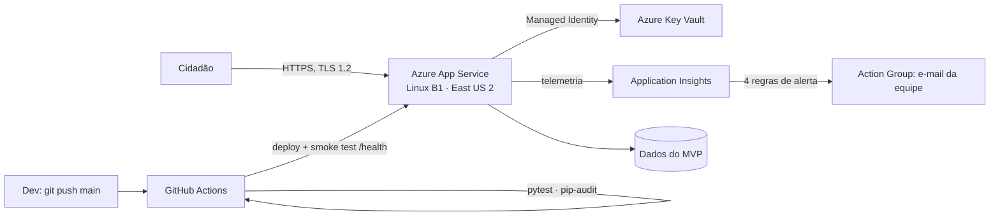

# CidadeViva

> **CitizenTech · Global Solution FIAP 2026.2 · Engenharia de Software, 4º ano**
> Disciplina de produção: *Secure DevOps Tools & Cloud Computing — "CitizenTech no Ar"*

| | |
|---|---|
| **MVP no ar** | <https://citizentech-girafas.azurewebsites.net> |
| **Health check** | <https://citizentech-girafas.azurewebsites.net/health> |
| **Repositório** | <https://github.com/delpadre/CidadeViva-Cloud> |

---

## Arquitetura de produção



Todos os recursos ficam no Resource Group `rg-citizentech`, região **East US 2**.

> **Por que East US 2?** A assinatura Azure for Students tem uma política que só permite criar recursos em North Central US, South Central US, Chile Central, East US 2 e Canada Central (o Brazil South retorna `RequestDisallowedByAzure`). Em produção real, o ideal é Brazil South, por latência e LGPD.

---

## Engenharia de produção

### 1. Deploy
- URL pública com **HTTPS obrigatório** (*HTTPS Only*), **TLS mínimo 1.2** (inclusive no SCM) e **FTP desabilitado**.
- Rota `GET /health` (retorna 200), usada pelo smoke test do pipeline, pelo health check do App Service e pelo Availability test.
- Infraestrutura reproduzível pelo script [`infra/setup-azure.sh`](infra/setup-azure.sh).

### 2. CI/CD (GitHub Actions)
Workflow [`.github/workflows/ci-cd.yml`](.github/workflows/ci-cd.yml), executado a cada push na `main`:

1. Instala dependências e roda **pytest**.
2. Audita vulnerabilidades das dependências com **pip-audit**.
3. Empacota a aplicação.
4. Faz o **deploy** no App Service (`azure/webapps-deploy`), só se as etapas anteriores passarem.
5. Executa um **smoke test** em `/health`.

Pull requests rodam apenas build e testes. Análise estática com **CodeQL** ([`codeql.yml`](.github/workflows/codeql.yml)) e **Dependabot** ([`dependabot.yml`](.github/dependabot.yml)) completam a esteira.

### 3. Segurança
| Controle | Como foi feito |
|---|---|
| Segredos fora do código | Key Vault (`kv-citizentech-girafas`) com referência `@Microsoft.KeyVault(...)` nas variáveis de ambiente do App Service; credenciais de deploy somente em *GitHub Secrets* |
| Sem senha no app | **Managed Identity** do App Service com o papel mínimo *Key Vault Secrets User* |
| Acesso por papéis (RBAC) | Proprietário no grupo de recursos; *Secrets Officer* (gestão) e *Secrets User* (app) no Key Vault |
| Transporte seguro | HTTPS only, TLS 1.2, FTP desabilitado |
| Código e dependências | CodeQL, Dependabot (alertas e atualizações de segurança), `pip-audit` |
| Repositório | `.gitignore` bloqueia `.env` e `publish-profile.xml`; `.env.example` documenta as variáveis sem valores |

**Limitação conhecida:** a autenticação básica SCM está habilitada porque o deploy usa *publish profile*. Uma melhoria futura é migrar para login federado (OIDC), que dispensa essa credencial.

### 4. Monitoramento
**Application Insights** (`ai-citizentech`) recebe requisições, falhas e exceções. Quatro regras de alerta notificam a equipe por e-mail (Action Group `ag-citizentech-equipe`):

| Alerta | Condição |
|---|---|
| `alerta-http-5xx` | Mais de 3 erros 5xx em 15 min |
| `alerta-lentidao` | Tempo médio de resposta acima de 3 s |
| `alerta-health-check` | Health check abaixo de 100% |
| `ping-health-ai-citizentech` | Availability test com falha em 2 ou mais locais |

Um **Availability test** (`ping-health`) verifica `/health` a cada 5 minutos, de 5 regiões.

### 5. Custo (estimativa mensal, East US 2)
| Recurso | US$/mês |
|---|---|
| App Service Linux B1 | 12,41 |
| Azure Monitor / Application Insights (1 GB/dia) | 1,50 |
| Key Vault (10 mil operações) | 0,03 |
| **Total** | **13,94** (≈ 167,28/ano) |

---

## LGPD e dados pessoais

- **Dados coletados:** o CidadeViva **não pede nome, e-mail nem telefone**. Coleta apenas os dados do relato: localização do problema (coordenadas do dispositivo, se o cidadão autorizar, ou o endereço digitado: CEP, rua, número aproximado, bairro, cidade e UF), o tipo e a descrição do problema, e um código de acompanhamento gerado pelo sistema.
- **Finalidade:** o endereço ou a localização servem para encaminhar o problema ao local certo; o tipo e a descrição, para classificar e priorizar o atendimento; o código, para o cidadão acompanhar o relato sem se identificar.
- **Minimização:** não há cadastro nem identificação do cidadão. O endereço informado é aproximado (número aproximado) e a geolocalização só é usada quando o cidadão clica em "Usar a minha localização". Os testes não usam dados pessoais reais.
- **Armazenamento e proteção:** o tráfego usa somente HTTPS (TLS 1.2); a chave administrativa (`ADMIN_KEY`) fica protegida e não está no código; o acesso à área do atendente exige essa chave. Os dados ficam no armazenamento do próprio App Service (`DATA_DIR`), criptografado em repouso pela plataforma Azure. 
- **Direitos do titular:** como não há identificação, o cidadão pode pedir a correção ou a exclusão de um relato informando o **código de acompanhamento**. A equipe atende o pedido em prazo razoável e remove o relato do armazenamento.

---

## Como rodar localmente

```bash
git clone https://github.com/delpadre/CidadeViva-Cloud.git
cd CidadeViva-Cloud
python -m venv .venv && source .venv/bin/activate    # Windows: .venv\Scripts\activate
pip install -r requirements.txt pytest
cp .env.example .env                                  # preencha localmente; nunca faça commit
pytest
python app.py                                         # http://localhost:8000
```

## Como publicar a infraestrutura

```bash
az login
GRUPO=girafas ALERT_EMAIL=seu@email.com bash infra/setup-azure.sh
```

Depois cadastre em *GitHub → Settings → Secrets and variables → Actions*:

| Secret | Valor |
|---|---|
| `AZURE_APP_NAME` | nome do app (ex. `citizentech-girafas`) |
| `AZURE_PUBLISH_PROFILE` | conteúdo do `publish-profile.xml` gerado pelo script (depois apague o arquivo) |

Cada push na `main` publica automaticamente.

---

## Estrutura do repositório

```
.
├── app.py                  # aplicação (rotas, /health e telemetria)
├── requirements.txt
├── pytest.ini
├── tests/                  # testes automatizados
├── infra/setup-azure.sh    # infraestrutura como script (az cli)
├── .github/
│   ├── workflows/ci-cd.yml # build, testes, deploy e smoke test
│   ├── workflows/codeql.yml
│   └── dependabot.yml
├── .env.example
└── .gitignore
```

