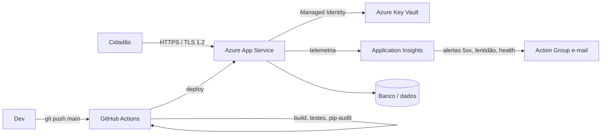

# [NOME DO PRODUTO] — CitizenTech

> Global Solution FIAP 2026.2 · Engenharia de Software 4º ano · Equipe: [NOMES + RMs]

## Ficha Técnica do MVP

| Campo | Conteúdo |
|---|---|
| **Nome do produto** | [preencher] |
| **Cidadão e território** | [ex.: moradores de X em Y que ...] |
| **Problema, em uma frase** | [preencher] |
| **Proposta de valor** | [preencher] |
| **Arquitetura: componentes** | Azure App Service (Linux) · Azure Key Vault · Application Insights · GitHub Actions · [banco/pipeline de dados · modelo de IA · robô UiPath] |
| **Fontes de dados** | [fontes públicas/abertas ou dados simulados com justificativa] |
| **Modelos de IA utilizados** | [OCR/visão, LLM, etc.] |
| **URL do MVP** | https://citizentech-[GRUPO].azurewebsites.net |
| **Repositório** | https://github.com/[ORG]/[REPO] |
| **Indicadores de impacto** | [ex.: tempo economizado, nº de atendimentos] |
| **ODS conectados** | [ex.: ODS 10, 11] |

## Arquitetura de produção



## Engenharia de produção

| Pilar | Implementação |
|---|---|
| Deploy | App Service Linux B1, HTTPS only, TLS ≥ 1.2, FTP desabilitado, health check em `/health` |
| CI/CD | `.github/workflows/ci-cd.yml`: testes → `pip-audit` → deploy → smoke test, a cada push na `main` |
| Segurança | Segredos no GitHub Secrets e Azure Key Vault (referência `@Microsoft.KeyVault`), Managed Identity, RBAC, CodeQL, Dependabot, secret scanning |
| Monitoramento | Application Insights + 3 alertas (5xx, lentidão, health check) com e-mail para a equipe + availability test |
| Custo | Ver PDF de entrega / Azure Pricing Calculator |

## LGPD e dados pessoais

- **Dados coletados:** [listar, ex.: e-mail, endereço]
- **Finalidade:** [por que cada dado é necessário]
- **Minimização:** só coletamos o estritamente necessário; sem dados pessoais reais em testes.
- **Armazenamento/proteção:** [onde, criptografia, retenção]
- **Direitos do titular:** [como solicitar exclusão/correção]

## Como rodar localmente

```bash
python -m venv .venv && source .venv/bin/activate
pip install -r requirements.txt
cp .env.example .env     # preencha localmente
pytest
python -m uvicorn main:app --reload   # ajuste ao seu entrypoint
```

## Como publicar (infraestrutura)

```bash
az login
GRUPO=g12 ALERT_EMAIL=voce@fiap.com.br bash infra/setup-azure.sh
```
Depois, cadastre os secrets `AZURE_APP_NAME` e `AZURE_PUBLISH_PROFILE` em *GitHub → Settings → Secrets and variables → Actions*. O app precisa expor `GET /health` retornando 200.

## Documentação por disciplina

[links para as pastas/READMEs de Dados, Visão, RPA, Maker Lab, etc.]
